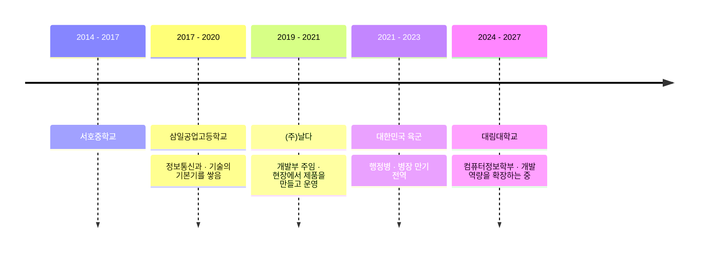
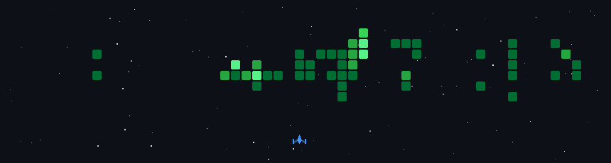

### 👋 About Me

- 🌱 여러 AI를 활용한 프로젝트들을 경험해보고 있습니다.
- 🗂 자세한 경력과 프로젝트는 **[포트폴리오](https://gunoo-p.github.io/)** 에서 볼 수 있어요.

 

### 🧭 My Journey

 

### 🛠 Tech Stack

| | |
|:--|:--|
| **Mobile** |   |
| **Frontend** |   |
| **Backend** |    |
| **Database** |   |
| **AI** |     |
| **IoT** |       |
| **Infra / DevOps** |      |
| **Collaboration** |     |

 

### 📌 Featured Projects

| 프로젝트 | 설명 | 기술 |
|:--|:--|:--|
| [🏭 반도체 클린룸 모니터링 대시보드](https://github.com/gunoo-p/cleanroom-dashboard) | 센서 데이터를 MQTT로 수집해 실시간 모니터링하고, Claude API로 이벤트 로그를 요약하는 웹 대시보드 | ESP32 · FastAPI · React · TimescaleDB · Docker |
| [💄 HUR](https://github.com/App-Legend/HUR) | 퍼스널 컬러 기반 메이크업 피드·화장품 탐색 뷰티 커뮤니티 앱 (백엔드 메인 · DevOps) | Flutter · Node.js · PostgreSQL · Docker |
| 🌡 비접촉 온도측정기 | ESP32와 적외선·초음파 센서로 만든 발열 체크·출입 관리 시스템, 개발부터 판매까지 주도 | ESP32 · Arduino C++ · OpenCV |

 

